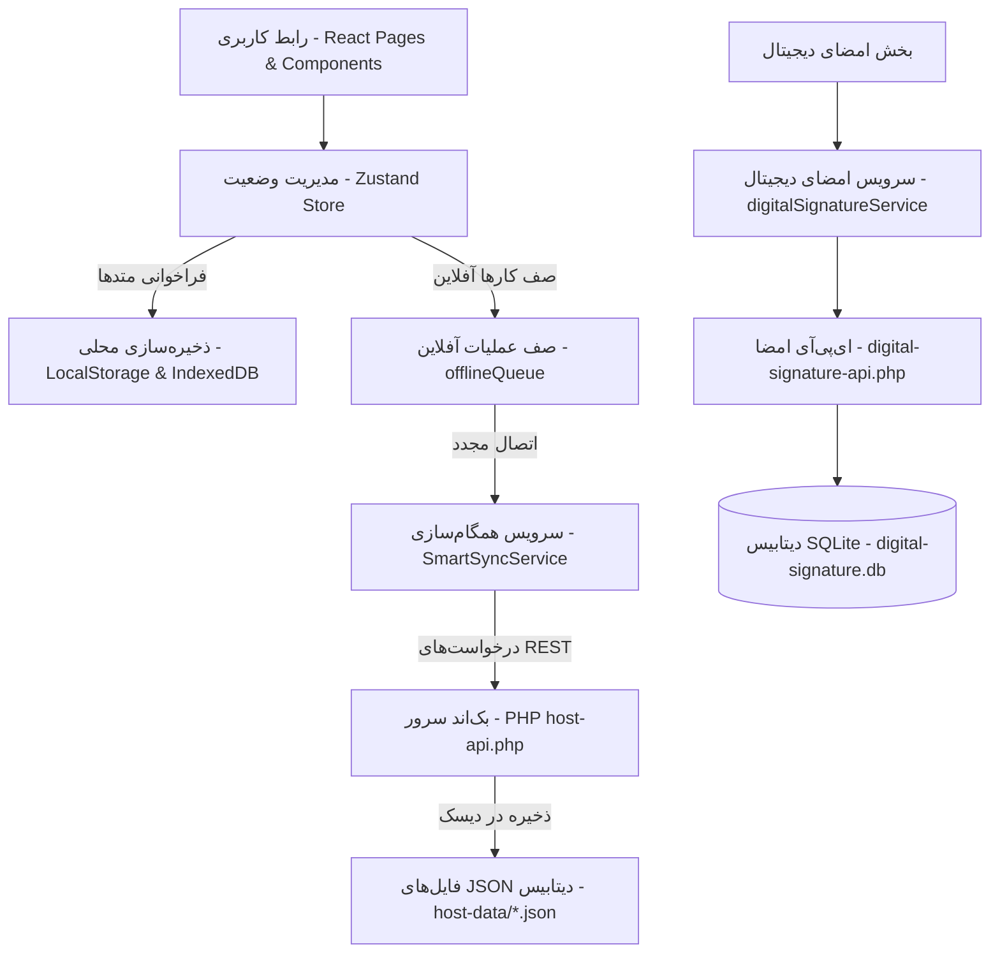

# مستند معماری پروژه اشک قلم (ARCHITECTURE.md)

این سند توصیف‌کننده ساختار پوشه‌ها، معماری کلی سیستم و جریان داده‌ها در نرم‌افزار حسابداری و امضای دیجیتال اشک قلم است.

---

## ۱. ساختار دایرکتوری‌ها (Directory Layout)

پروژه به دو بخش عمده تقسیم می‌شود: **فرانت‌اند مدرن تک‌صفحه‌ای (React SPA)** و **ای‌پ‌آی‌های سبک بک‌اند (PHP REST APIs)** که مستقیماً در کنار فرانت‌اند در ریشه پروژه قرار گرفته‌اند.

```
root/
│
├── .vscode/                 # تنظیمات ادیتور VSCode
├── components/              # کامپوننت‌های بازاستفاده فرانت‌اند (UI Components)
│   ├── AdvancedDashboard.tsx # داشبورد پیشرفته با نمودارها و آمارها
│   ├── InvoicePrint.tsx     # قالب رسمی و بهینه‌شده چاپ فاکتور فروش/خرید
│   ├── DigitalSignatureManager.tsx # مدیریت محلی امضاهای دیجیتال
│   ├── IranianPlatePicker.tsx # کامپوننت انتخاب پلاک خودروی ایرانی
│   ├── ErrorBoundary.tsx    # مرز کنترل خطاهای کامپوننت‌ها
│   └── ...                  # سایر کامپوننت‌های تعاملی
│
├── pages/                   # صفحات اصلی نرم‌افزار (منطبق بر تب‌ها و دسترسی‌ها)
│   ├── Dashboard.tsx        # داشبورد مدیریتی خلاصه
│   ├── Invoices.tsx         # لیست و فرم‌های ثبت فاکتور
│   ├── Inventory.tsx        # مدیریت انبار و موجودی کالاها
│   ├── Checks.tsx           # سیستم مدیریت و واگذاری چک‌های بانکی
│   ├── AIFinancialAssistant.tsx # دستیار مالی هوشمند (مبتنی بر مدل Gemini)
│   └── ...                  # سایر صفحات اصلی سیستم
│
├── services/                # منطق تجاری سیستم (Business Logic Layer)
│   ├── smartSyncService.ts  # همگام‌سازی هوشمند داده‌ها و حل تضادها
│   ├── indexedDBService.ts  # مدیریت ذخیره‌سازی محلی در دیتابیس مرورگر
│   ├── geminiService.ts     # ارتباط با API هوش مصنوعی جمینای گوگل
│   ├── rbacService.ts       # اعتبارسنجی دسترسی‌ها بر اساس نقش کاربر
│   ├── deletionRegistryService.ts # ثبت سوابق رکوردهای حذف‌شده محلی
│   └── ...                  # سرویس‌های کمکی (پشتیبان‌گیری، نرخ ارز، محاسبات مالیات و...)
│
├── host-data/               # [پوشه پویا در سرور] ذخیره‌سازی داده‌های JSON برنامه
├── digital-signature-storage/ # [پوشه پویا در سرور] فایل‌های امضای دیجیتال
│
├── App.tsx                  # فایل ورودی اصلی نرم‌افزار React و مسیریاب
├── store.ts                 # تعریف وضعیت گلوبال برنامه با Zustand و Persistence
├── types.ts                 # تعاریف تایپ‌های اصلی (فاکتور، کالا، کاربر، چک و حواله انبار)
├── config.ts                # فایل پیکربندی آدرس‌ها و اولویت‌های ذخیره‌سازی
│
# بک‌اند (PHP REST APIs):
├── host-api.php             # هاب اصلی خواندن، نوشتن و همگام‌سازی داده‌های عمومی (JSON)
├── digital-signature-api.php # مدیریت فرآیند درخواست و ثبت امضاهای دیجیتال
├── digital-signature-db.php # هندلینگ دیتابیس SQLite برای فرآیندهای امضا
├── audit-trail-api.php      # ثبت وقایع و لاگ‌های امنیتی بر روی سرور
└── server-api-backup.php    # پشتیبان‌گیری فایل‌ها و داده‌ها روی سرور
```

---

## ۲. معماری سیستم (System Architecture)

معماری پروژه اشک قلم بر پایه الگوی **محلی-اول (Local-First)** با معماری چندلایه‌ای طراحی شده است:



### بخش‌های معماری:
1.  **رابط کاربری (UI Layer):** پیاده‌سازی شده با React 19، Tailwind v4 و کامپوننت‌های منعطف متناسب با ویژگی‌های وب‌سایت‌های ایرانی (راست‌چین، پلاک‌نویسی، تاریخ جلالی).
2.  **مدیریت وضعیت محلی (Zustand State Store):** به عنوان منبع واحد حقیقت (Single Source of Truth) در کل برنامه کار می‌کند. تمام صفحات تغییرات خود را مستقیماً روی Store اعمال می‌کنند.
3.  **سرویس‌های همگام‌سازی (Sync & Service Layer):**
    *   **همگام‌سازی دوطرفه:** داده‌ها را از هاست می‌خواند و با دیتابیس محلی تلفیق می‌کند.
    *   **حل تضادها (Conflict Resolution):** با استفاده از فیلدهای برچسب زمانی (`updatedAt`) جدیدترین تغییرات را شناسایی کرده و تضادهای ویرایش یا حذف همزمان را با الگوریتم‌های هوشمند برطرف می‌سازد.
    *   **رجیستری حذفیات (Deletion Registry):** برای اعمال هماهنگ حذف رکوردهایی که آفلاین حذف شده‌اند، شناسه‌ها را تا زمان همگام‌سازی نهایی در دیتابیس نگه می‌دارد.
4.  **ذخیره‌سازی بک‌اند سبک:** به جای دیتابیس سنگین مانند MySQL، داده‌های مربوط به فاکتورها، اشخاص و کالاها در فایل‌های مجزای JSON ذخیره می‌شوند تا به ساده‌ترین شکل و بدون سربار روی هاست اشتراکی اجرا شوند. سیستم امضا برای پایداری و امنیت بالا از دیتابیس محلی SQLite متصل به PHP استفاده می‌کند.

---

## ۳. جریان داده‌ها (Data Flow)

### الف. ثبت داده جدید در حالت عادی (آفلاین / آنلاین)
1.  کاربر داده‌ای (مثلاً یک فاکتور فروش جدید) را در رابط کاربری ثبت می‌کند.
2.  کامپوننت متد `addInvoice` را از `useStore` فراخوانی می‌کند.
3.  داده به سرعت به دیتابیس محلی (LocalStorage / IndexedDB) منتقل شده و UI بدون معطلی به‌روزرسانی می‌شود.
4.  سرویس `realConnectionService` به طور منظم وضعیت اینترنت را پایش می‌کند:
    *   **اگر آنلاین باشد:** درخواست ارسال فاکتور فوراً از طریق `hostDB.save` به `host-api.php?action=save` ارسال می‌شود و در هاست اصلی ذخیره می‌گردد.
    *   **اگر آفلاین باشد:** این فاکتور با متد `addOfflineOperation` به صف کارهای محلی (`offlineQueue`) افزوده می‌شود. پس از برقرار شدن دوباره اتصال اینترنت، صف مذکور خوانده شده و داده‌ها تک به تک با سرور همگام‌سازی می‌شوند.

### ب. فرآیند امضای دیجیتال فاکتور
1.  مدیر سیستم یک فاکتور ثبت کرده و درخواست امضا صادر می‌کند (`RequestSignatureModal.tsx`).
2.  یک لینک امضا حاوی توکن یکبار مصرف منحصربه‌فرد بر روی سرور SQLite ایجاد می‌شود.
3.  مشتری با کلیک روی لینک وارد صفحه عمومی امضا (`SimpleSignaturePage.tsx` یا `PublicSignaturePage.tsx`) می‌شود.
4.  مشتری امضای خود را ترسیم می‌کند. این امضا به همراه برچسب زمانی ایرانی، IP فرستنده و متادیتای سیستم فشرده‌سازی شده و به صورت امن به بک‌اند ارسال می‌گردد.
5.  پس از تایید کد تایید موقت (OTP) پیامکی یا ایمیلی، امضا در دیتابیس SQLite ثبت شده و فاکتور اصلی در سیستم با وضعیت «امضاشده» به‌روزرسانی می‌شود.
